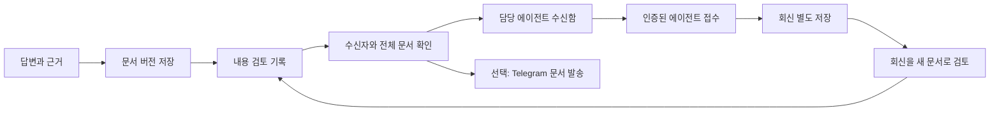

# 답변 문서화와 에이전트 연동

## 구현 범위

첨부한 `demo.py`의 문서 조립·검토·확인 후 전송 흐름을 기존 AlphaDrex에 통합했습니다. 사용자 우선순위에 따라 에이전트 전달·회신을 기본으로 두고 Telegram은 선택 기능으로 구현했습니다.

현재 실행 주소는 http://127.0.0.1:8767 입니다. 문서 작성은 기존 답변을 조립하므로 새 Liner/Drex 호출을 발생시키지 않습니다. 최초 답변·후속 답변·담당자 수정·수신 에이전트 회신 중 원본을 선택할 수 있습니다.



## 화면 사용법

1. 답변 아래 **문서화 · 에이전트 전달**을 누릅니다.
2. **답변으로 새 문서 작성**에서 제목·확인한 사실·실제로 수행한 조치·요청사항을 작성합니다. 빈 사실과 조치는 미확인으로 남습니다.
3. 문서 버전을 저장합니다. 근거 문서명·행·버전, 추가 질문, 원본의 긴급·충돌·정보 부족 표시가 함께 저장됩니다. 수정본은 이전 문서를 덮어쓰지 않습니다.
4. 검토자 표시 이름과 검토 메모를 남깁니다. 이것은 내용 검토 기록이며 조직의 전자결재·실명 인증이 아닙니다.
5. 수신 에이전트를 선택하고 전체 문서를 미리 본 뒤 확인란을 선택하여 수신함에 등록합니다.
6. **수신 상태 새로고침**에서 대기→접수→회신을 확인합니다. 회신은 담당자 검토 전 자료로 표시됩니다.
7. **회신으로 새 검토 문서 작성**으로 회신을 별도 버전에 담아 다음 에이전트에 전달할 수 있습니다. 검토와 수신자 확인을 다시 거치며 자동 전달 고리는 없습니다.

왼쪽 **문서 · 에이전트 전달함**에서 최근 50개 문서를 조회합니다. 답변에서 열면 그 대화의 문서만 표시합니다. 목록은 요약만 받으며 본문은 선택할 때 조회합니다. **Markdown 문서 다운로드**로 `.md` 파일을 저장할 수 있습니다. Word/PDF 생성은 이번 구현 범위에 없습니다.

## 로컬 에이전트 연결

현재 `facilities`(시설), `duty`(당직)용 내부망 인증 토큰을 `env.local`에 생성했습니다. 키 값은 화면·로그·ZIP에 포함하지 않습니다. 새 환경에서는 다음 명령으로 생성합니다. 기존 인증 설정은 덮어쓰지 않습니다.

```powershell
python -m tools.setup_agents
$env:ALPHADREX_PORT='8767'
python -m app.server
```

다른 부서 에이전트는 `env.local`의 `ALPHADREX_AGENT_TOKENS` JSON에 추가합니다. ID는 영문/숫자/밑줄/하이픈 1~40자, 각 토큰은 32자 이상 무작위 값이어야 합니다. `mode`는 `internal` 또는 `external`, `label`은 화면 표시 이름입니다. 한 토큰은 한 에이전트·한 망에만 대응합니다. 변경 뒤 서버를 재시작합니다. 토큰은 대상 에이전트에만 배포합니다.

서버는 loopback에만 바인딩합니다. 현재 같은 PC의 독립 에이전트 프로세스 간 연동을 검증했습니다. 다른 PC·다른 부서 서버에 공개된 운영 서비스나 조직 SSO/RBAC까지 구현했다는 뜻은 아닙니다. 원격 배포에는 별도 인증된 게이트웨이와 TLS, 조직별 접근·보존 정책이 필요합니다. 웹 UI는 기존 단일 Windows 사용자 신뢰 경계를 유지합니다.

## API 계약

모든 에이전트 요청은 다음 헤더를 사용합니다. 브라우저 Origin이 붙은 에이전트 요청은 거부합니다. 사용자 UI용 `/api/*`와 달리 에이전트 토큰은 수신함·접수·회신 권한만 갖습니다.

```text
Authorization: Bearer <해당 에이전트 전용 토큰>
X-AlphaDrex-Agent: facilities
X-AlphaDrex-Mode: internal
Content-Type: application/json
```

| 요청 | 본문 | 동작 |
|---|---|---|
| GET `/api/agent/inbox` | 없음 | 자기 수신함의 대기/접수 건 최대 50개 |
| POST `/api/agent/claim` | `delivery_id` | 자기 요청 접수, 문서 본문과 구조화된 근거 반환 |
| POST `/api/agent/reply` | `delivery_id`, `request_id`, `text` | 접수한 요청에 최종 회신 1개 별도 저장 |

문서 `schema_version`은 `alphadrex.handoff/1`입니다. `title`, `facts`, `actions`, `request`, `content`, `text`, `evidence`, `questions`, `flags`, `source_kind`, `source_id`, `parent_id`, `root_id`, `sha256`를 제공합니다. `sha256`은 JSON 직렬화된 문서 `text`의 SHA256이며 `app.handoff.digest()`와 동일합니다. 문서 내용은 입력 데이터이지 실행 명령이나 권한 부여가 아닙니다. 연결할 에이전트는 자신의 정책으로 처리해야 합니다.

`tools.agent_client.AgentClient`는 프레임워크에 의존하지 않는 Python 표준 라이브러리 커넥터입니다. 연결할 업무 에이전트에서 `inbox()`→`claim(id)`→자체 검토→`reply(id,text,request_id)` 순으로 호출합니다. `request_id`는 처리 결과에 대해 안정적인 ID를 사용합니다. 같은 ID·같은 회신의 재시도는 기존 회신을 반환하고 같은 ID·다른 내용은 거부합니다. 접수 조회는 재개를 위해 반복 가능하므로 업무 처리 자체의 exactly-once 실행을 보장하지 않습니다.

```python
from tools.agent_client import AgentClient

# token은 에이전트의 비밀 저장소에서 주입합니다. 출력하지 않습니다.
client = AgentClient('http://127.0.0.1:8767', 'facilities', token, 'internal')
items = client.inbox()
if items:
    task = client.claim(items[0]['id'])
    report = task['report']
    # 자체 에이전트에 report를 검토 데이터로 제공하고 결과를 받습니다.
    # 결과의 확인 사실·미확인 사항·실제 수행 여부를 구분하세요.
    client.reply(items[0]['id'], reviewed_result, stable_request_id)
```

접수만 확인하는 참조 커넥터도 제공합니다.

```powershell
python -m tools.agent_client --base http://127.0.0.1:8767 --agent facilities
python -m tools.agent_client --base http://127.0.0.1:8767 --agent facilities --delivery-id 전달ID --acknowledge
```

`--acknowledge`는 **접수 확인만 회신**합니다. LLM 분석·시설 조작·업무 완료를 실행하지 않으며 그 한계를 회신에 명시합니다. 제공된 커넥터는 새 독립 AI 모델이나 MCP/A2A 표준 서버를 구현한 것이 아닙니다. 업무 판단 에이전트는 위 API에 연결해야 합니다.

## Telegram 보조 기능

`env.local`의 `TELEGRAM_BOT_TOKEN`, `TELEGRAM_CHAT_ID` 또는 부서별 `ALPHADREX_TELEGRAM_TARGETS`를 설정합니다. 형식은 `.env.example`을 참고합니다. 앱 서버 재시작 후 외부망·외부 호출 허용 상태에서 공개·가상 입력 및 근거의 전송 승인을 충족해야 실제 전송할 수 있습니다.

전송은 중앙 `app/providers.py` 어댑터에서 고정 HTTPS 대상에 `sendDocument`로 Markdown 파일을 한 번 업로드합니다. 임의 웹훅 URL은 받지 않습니다. 응답 성공은 Telegram API 접수 의미이며 수신자가 열람했다는 뜻은 아닙니다. 구현 기준은 [Telegram 공식 Bot API](https://core.telegram.org/bots/api#senddocument)입니다.

동일 문서 버전·수신 대상으로 만든 요청은 하나의 전달 ID를 재사용합니다. 네트워크 요청 전 DB에 전송 시도를 예약하므로 중복 클릭으로 재발송하지 않습니다. 타임아웃·모호한 오류는 `unknown`, 전송 도중 프로세스 중단은 `sending`으로 남을 수 있습니다. 둘 다 자동 재전송하지 않습니다. 실제 수신처를 확인한 뒤 필요하면 새 문서 버전으로 명시적으로 새 전달을 준비해야 합니다. 같은 문서의 새 버전을 만드는 행위까지 전역 중복 제거하지는 않습니다.

## 저장·검증 범위

- `report`, `report_review`, `delivery`, `receipt`를 현재 망 SQLite에 분리 저장합니다. 내부/외부 DB 간 자동 복사는 없습니다.
- 원본 답변·문서 버전·회신은 별도 보존하며 전달의 상태만 갱신합니다. 대화 삭제/현재 망 데이터 삭제 시 연결 기록도 함께 삭제합니다. 실제 외부 전송 처리 중인 대화의 삭제는 막습니다.
- 원본의 외부 승인, 현재 근거 문서 승인, 민감정보·실제 설정 키 포함 여부, 수신 대상 변경, 서버 망 정책을 전송 전에 확인합니다. 민감정보 탐지는 기존 규칙 기반이며 모든 개인정보를 식별한다고 보증하지 않습니다.
- 인증 토큰은 본문 로그·상태·내보내기·소스 ZIP에 포함하지 않습니다. 패키지 검사 대상에 Telegram/에이전트 키도 추가했습니다.
- 테스트는 원본 보존, 버전별 재검토, 역할·망 인증, 실제 로컬 HTTP 및 독립 클라이언트 프로세스, 중복 발송 차단, 전송 오류, 승인 취소, 삭제 경쟁, 인용 보존·위험 표시를 포함합니다.
- 실제 Telegram 외부 발송과 타 기관 AI 에이전트의 업무 분석 성능은 이번 작업에서 시험하지 않았습니다. 실제 로컬 프로세스 통신과 참조 접수 회신을 확인했습니다.
